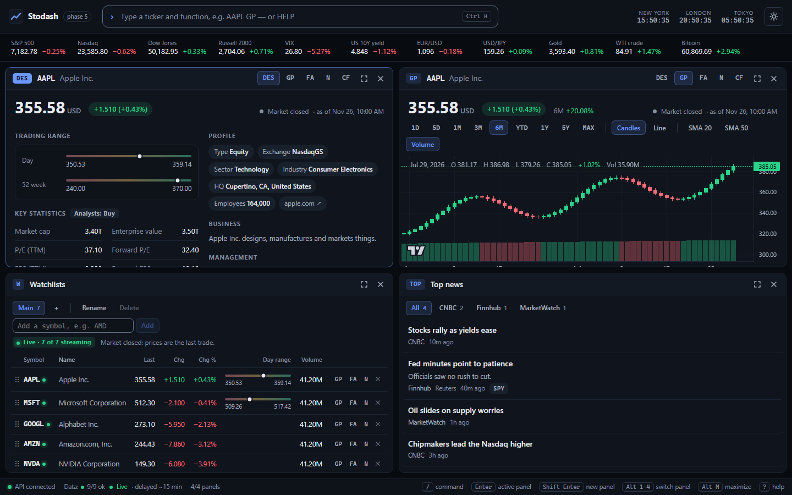
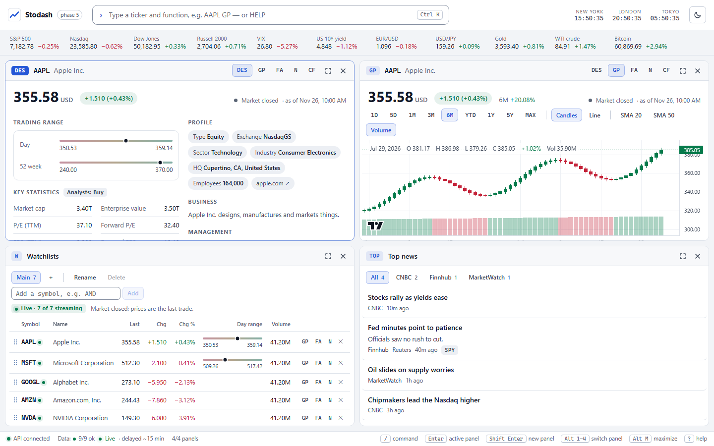
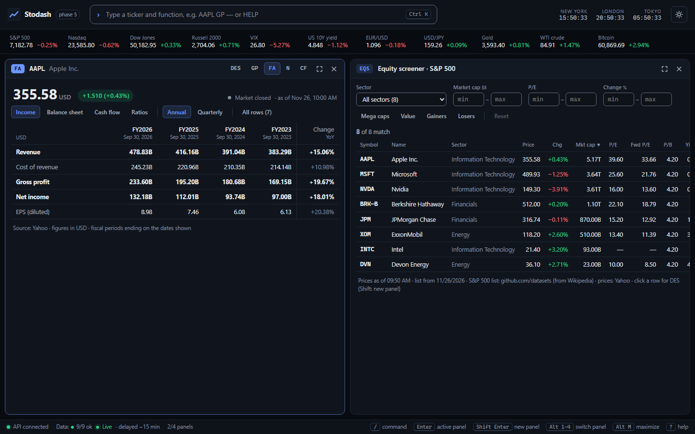
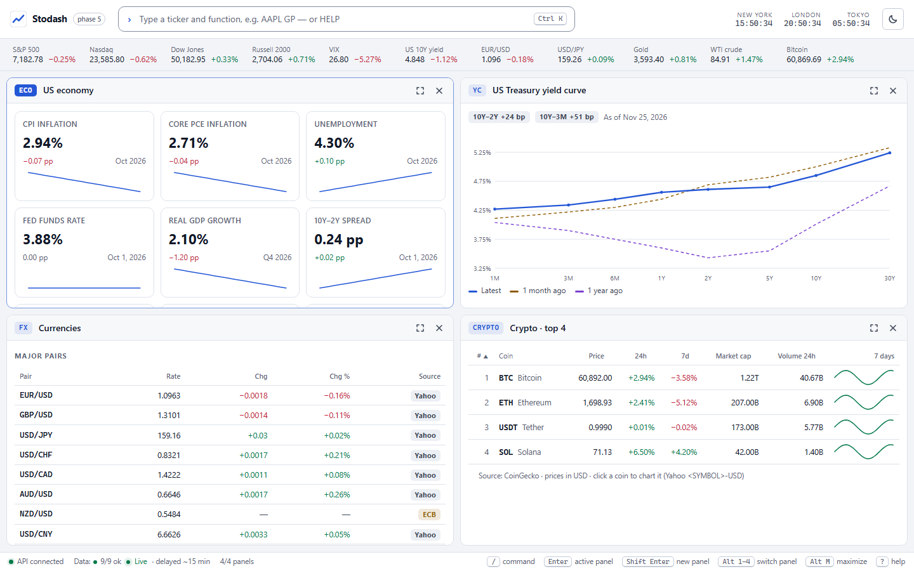

# Stodash

A personal, keyboard-driven market terminal inspired by the Bloomberg Terminal, built on free data.
**Phases 1–5 (all done):** command bar, company description (`DES`), price charts (`GP`), financial statements (`FA`),
company news (`N`), SEC filings (`CF`), watchlists with live prices (`W`), the US economy (`ECO`), the Treasury yield
curve (`YC`), currencies (`FX`), crypto (`CRYPTO`), top market headlines (`TOP`), an S&P 500 screener (`EQS`),
saved layouts (`LAYOUT`), resizable panels, keyboard shortcuts, and dark and light themes that meet WCAG AA contrast.



<details>
<summary>More screenshots (light mode, research, macro)</summary>





The screenshots use the test suite's made-up data. Regenerate them with `cd frontend; npm run screenshots`.
</details>

- **Backend:** ASP.NET Core minimal API on .NET 10 (`backend/Stodash.Api`)
- **Frontend:** React 19 + TypeScript + Vite, charts by TradingView Lightweight Charts (`frontend`)
- **Database:** SQL Server LocalDB via EF Core (watchlists, saved layouts, and a cache that survives restarts)
- **Data:** Yahoo Finance (no key), SEC EDGAR (free, needs a contact email), FRED (free key), US Treasury, CoinGecko,
  the ECB, news RSS feeds and the open S&P 500 list (no key), with optional Finnhub for live watchlist prices and news

> For personal research only. Free data is usually delayed ~15 minutes, and provider terms
> generally forbid redistributing it, so don't deploy this publicly.

## Build and run

Stodash has two parts that run at the same time:

| Part | Folder | Address | Started with |
|---|---|---|---|
| API (backend) | `backend/Stodash.Api` | http://localhost:5080 | `dotnet run` |
| Web app (frontend) | `frontend` | http://localhost:5173 | `npm run dev` |

You open the web app in your browser. It talks to the API, and the API fetches the market data.

### Quick start: the scripts

The `scripts` folder does everything in steps 2–4 for you:

| Script | What it does |
|---|---|
| `scripts\start.cmd` | **Double-click to start.** Checks prerequisites, runs `npm install` if needed, opens the API and web app in two windows ("Stodash API" and "Stodash Web", where the logs appear), waits until both are up, then opens your browser. If Stodash is already running, it just opens the browser. |
| `scripts\stop.cmd` | **Double-click to stop.** Closes both windows and frees ports 5080 and 5173, including servers you started by hand. |
| `scripts\start.ps1` / `stop.ps1` | The same, from a PowerShell prompt. `start.ps1 -NoBrowser` skips opening the browser. |

From PowerShell in this folder:

```powershell
.\scripts\start.ps1
```

```powershell
.\scripts\stop.ps1
```

If PowerShell says running scripts is disabled, use the `.cmd` files instead. They run the same scripts without changing
your system's PowerShell settings.

The rest of this section is the manual way, which is useful for understanding what the scripts do or when one fails.

### 1. Install the prerequisites (once)

- **.NET 10 SDK:** https://dotnet.microsoft.com/download/dotnet/10.0
- **Node.js 20 or newer** (includes npm): https://nodejs.org
- **SQL Server LocalDB:** comes with Visual Studio (the "Data storage and processing" workload), or install
  [SQL Server Express LocalDB](https://learn.microsoft.com/sql/database-engine/configure-windows/sql-server-express-localdb).
  Without it Stodash still runs, but watchlists don't work and the cache resets on every restart.

Check that they're installed:

```powershell
dotnet --list-sdks
```

```powershell
node --version
```

```powershell
sqllocaldb info
```

The first should list a `10.x` version, the second should print `v20` or higher, and the third should list
`MSSQLLocalDB`. The API creates its `Stodash` database on first start. You don't need to set anything up.

### 2. First-time setup (once)

Open PowerShell in this folder (`C:\Users\rimaz\source\repos\vibe-code\stodash`), then install the front-end packages:

```powershell
cd frontend; npm install; cd ..
```

The backend downloads its packages automatically the first time it builds.

### 3. Start the app (every time)

You need **two terminals**, both opened in this folder.

**Terminal 1, the API.** Leave it running:

```powershell
dotnet run --project backend/Stodash.Api
```

Wait for `Now listening on: http://localhost:5080`.

**Terminal 2, the web app.** Leave it running:

```powershell
cd frontend; npm run dev
```

Wait for `Local: http://localhost:5173/`.

**Then open http://localhost:5173 in your browser.** The status bar at the bottom should say **API connected**.

### 4. Stop the app

Press `Ctrl+C` in each terminal.

### Build and check without running

Use these to confirm everything compiles, for example after editing code:

```powershell
dotnet build Stodash.slnx
```

```powershell
dotnet test backend/Stodash.Api.Tests
```

```powershell
cd frontend; npx tsc -b; npx oxlint src; npm run build; cd ..
```

The .NET build should end with `0 Warning(s)` and `0 Error(s)`, and `dotnet test` with `Passed!`. The `tsc` and `oxlint` steps print nothing when everything
is fine, and `npm run build` ends with `✓ built` and writes the optimized site to `frontend/dist`.

To run that optimized build instead of the dev server, start the API as in step 3, then:

```powershell
cd frontend; npm run build; npm run preview
```

It serves on http://localhost:4173 and still talks to the API on :5080.

### Using Visual Studio or VS Code instead

- **Visual Studio:** open `Stodash.slnx` and press F5 to run the API. Then start the web app from a terminal as in step 3.
- **VS Code:** open this folder, then use two integrated terminals (`` Ctrl+` ``) for the two commands in step 3.

### Troubleshooting

| Problem | Fix |
|---|---|
| Status bar says **API offline** | Terminal 1 isn't running, or it crashed. Start it again and check its output for errors. |
| `address already in use` on 5080 or 5173 | An old copy is still running. Close the other terminal, or find it with `Get-NetTCPConnection -LocalPort 5080` and stop that process. |
| Panels say **Data provider unavailable** (502) | Yahoo is rate-limiting or briefly down. Wait a minute and retry, or add a Finnhub key (below). |
| Watchlists say **Database unavailable** (503) | LocalDB isn't running or isn't installed. Run `sqllocaldb start MSSQLLocalDB`, or install it (step 1). |
| Watchlists show **Polling** instead of **Live** | No Finnhub key, the market is closed, or the symbols aren't US stocks. Hover over the badge for details. |
| `dotnet` or `npm` is not recognized | The prerequisite isn't installed, or the terminal was opened before installing. Open a new terminal. |
| The page looks stale after updating code | Refresh the browser. If it's still stale, stop both terminals and start them again. |

### SEC EDGAR setup (for `CF`, and the `FA` fallback)

SEC's data is free with no sign-up, but SEC asks every automated client to identify itself with a name and contact
email in its User-Agent header, and blocks requests without one. The address is only sent to sec.gov and only appears
in their server logs. Set it once with user-secrets so it never ends up in the repo:

```powershell
dotnet user-secrets set "Sec:UserAgent" "Stodash you@example.com" --project backend/Stodash.Api
```

Without it, `CF` shows "SEC EDGAR is not configured" and the status bar shows SEC as off. Everything else still works.

### FRED key (for `ECO`)

`ECO` uses the St. Louis Fed's free FRED data, which needs a free key: https://fred.stlouisfed.org/docs/api/api_key.html.
Then:

```powershell
dotnet user-secrets set "Fred:ApiKey" "YOUR_KEY" --project backend/Stodash.Api
```

Restart the API afterwards. Until a key is set, `ECO` shows how to set it, and everything else works.

### Optional: Finnhub

Finnhub has a free plan (sign up with an email, no card). With a key:
- watchlist prices for US stocks stream live (otherwise they refresh every 15 seconds),
- quotes and profiles fall back to Finnhub when Yahoo fails,
- and `N` merges Finnhub's company news with Yahoo's.

Get a free key at https://finnhub.io/register, then:

```powershell
dotnet user-secrets init --project backend/Stodash.Api
```

```powershell
dotnet user-secrets set "Finnhub:ApiKey" "YOUR_KEY" --project backend/Stodash.Api
```

The key stays on the backend and never reaches the browser.

`CRYPTO` needs no key or account. It uses CoinGecko's keyless public API (about 5 calls a minute, shared), and Stodash
makes one call every 2 minutes at most. Only if you ever see CoinGecko rate-limit errors, create a free Demo account
on CoinGecko's API pricing page, generate a key in its developer dashboard, and set it:
`dotnet user-secrets set "CoinGecko:ApiKey" "YOUR_KEY" --project backend/Stodash.Api`.

To check that every key works after adding or changing one, restart the API, then run:

```powershell
curl.exe -s "localhost:5080/api/health?check=true"
```

The `check` section lists each provider as `ok`, `failed` (with the provider's own error, such as an invalid key) or
`skipped` (no key set). It makes one small call per provider and only runs when you ask. Repeating it within 30
seconds returns the same result.

The status bar shows "Data: ● 9/9 ok" (10 with a Finnhub key). Hover over it to see every provider's state. A failing provider is also named
in red, and "● Live" appears while watchlist prices are streaming.

## Running the tests

Stodash has browser tests written with [Playwright](https://playwright.dev), which open the app in a real Chromium
browser and click and type through it the way you would, plus fast unit tests for the backend's parsing and filtering:

| Suite | Command | Needs the backend? | What it checks |
|---|---|---|---|
| **Main** (100 tests, ~25 s) | `npm run test:e2e` (from `frontend`) | No | Every usual scenario, using a fake API with fixed data, plus automated accessibility checks |
| **Live smoke** (11 tests) | `npm run test:e2e:live` (from `frontend`) | Yes, on :5080 | Every function loads with real data (W needs LocalDB) |
| **Backend unit** (69 tests, ~1 s) | `dotnet test backend/Stodash.Api.Tests` | No | Symbol rules, JSON readers, RSS and CSV parsing, screener filtering, FA/CF mapping, layout checks |

The main suite covers:
- the default layout, the market strip and the status bar;
- the command bar: Enter, Shift+Enter, the 4-panel limit, suggestions, company names, error messages, history,
  HELP, CLEAR, and `W DES` meaning the ticker W;
- every panel: FA, N and CF; watchlists (create, rename, delete, add, remove, `W ADD`, live prices through a
  simulated stream, the polling fallback); ECO, YC, FX and CRYPTO; TOP, EQS and saved layouts;
- resizing panels by mouse and keyboard, maximizing, and the Alt shortcuts;
- Retry buttons, "stale" badges, the offline banner, empty states, keyboard-operable rows, and the light/dark switch;
- **accessibility:** [axe](https://github.com/dequelabs/axe-core) checks every panel against WCAG 2.1 A and AA in both
  themes (`e2e/a11y.spec.ts`);
- settings that survive a reload, and what happens when the backend, the database or a provider fails.

Its fake API lives in `frontend/e2e/mock-api.ts`, so results never depend on Yahoo, SEC or market hours.

### 1. One-time setup

After installing the prerequisites in step 1 above, open PowerShell in this folder and run:

```powershell
cd frontend; npm install; npx playwright install chromium; cd ..
```

The last command downloads the Chromium build Playwright drives (about 150 MB, stored under
`%LOCALAPPDATA%\ms-playwright`). Repeat it after updating `@playwright/test`.

### 2. Run the main suite

```powershell
cd frontend; npm run test:e2e
```

You don't need to start anything first. The tests start their own copy of the web app on http://localhost:5199 and
stop it afterwards, so they won't clash with an app you have open on :5173. A passing run ends with `100 passed`.

### 3. Run the live smoke tests (optional)

Start Stodash first (`.\scripts\start.ps1 -NoBrowser`), then:

```powershell
cd frontend; npm run test:e2e:live
```

These hit real providers, so a failure can just mean Yahoo is rate-limiting. Check the status bar and try again in a
minute.

### Handy variations

Run these from the `frontend` folder:

| To | Run |
|---|---|
| Pick and watch tests in Playwright's interactive runner | `npm run test:e2e:ui` |
| Watch the browser while tests run | `npm run test:e2e -- --headed` |
| Run one file | `npm run test:e2e -- e2e/financials.spec.ts` |
| Run tests whose name matches some text (a regex) | `npm run test:e2e -- -g "up to four"` |
| Step through a test with the inspector | `npm run test:e2e -- -g "up to four" --debug` |
| Check for flaky tests | `npm run test:e2e -- --repeat-each=3` |

### When a test fails

The terminal shows which step failed and what the page contained. For more detail, open the HTML report with
`npx playwright show-report`. Each failure has a screenshot and a trace you can step through, before and after every
action. The files are in `frontend/test-results` and `frontend/playwright-report`, which git ignores.

| Problem | Fix |
|---|---|
| `Executable doesn't exist` or "browser not installed" | Run `npx playwright install chromium` |
| `Port 5199 is already in use` | A previous test run is still going. Close it, or find it with `Get-NetTCPConnection -LocalPort 5199` |
| A test fails after you changed an API response | Update the matching fixture in `frontend/e2e/mock-api.ts` so the fake API returns the new shape |
| Live tests fail with "Couldn't load" | Make sure the API is running on :5080 and the status bar says "API connected" |

### Adding a test

Specs live in `frontend/e2e`, one file per area (`shell`, `command-bar`, `financials`, `news`, `filings`, `top`, `screener`, `layouts`, `workspace`, `polish`, `a11y`, ...). Import
`test` and the helpers from `./fixtures.ts`. The fake API is installed automatically for every test, and
`openWith(page, panels)` starts the app with a given layout. To simulate a failure, override a route:

```ts
mock.on(/^\/api\/news\//, { status: 502, body: { title: 'Data provider unavailable', detail: 'Yahoo is down.' } })
```

## Using it

Type into the command bar (or just start typing anywhere):

| Command | What it does |
|---|---|
| `AAPL` or `AAPL DES` | Description: price, day and 52-week ranges, key stats, profile, management |
| `AAPL GP` | Price chart: 1D–MAX ranges, candles or line, SMA 20/50, volume, hover legend |
| `AAPL GP 1Y` | Chart opened at a given range |
| `AAPL FA` | Financials: income statement, balance sheet, cash flow and ratios; key rows with an "All rows" toggle |
| `AAPL FA Q` | Financials opened on quarterly periods (`A` for annual) |
| `AAPL N` | Latest company headlines, newest first; links open in a new tab |
| `AAPL CF` | SEC filings with filters (Annual, Quarterly, 8-K, Proxy, Insider, Other) and links to EDGAR |
| `tesla` | A company name works too: Enter opens the best match |
| `W` | Watchlists: tabs per list, ＋ to create, Rename, Delete; live prices for US stocks; drag rows to reorder |
| `W Tech` | Open the watchlist called Tech |
| `W ADD NVDA` / `W DEL NVDA` | Add or remove a symbol (add `TO Tech` / `FROM Tech` for another list) |
| `ECO` / `ECO CPI` | US economy: 9 indicators from FRED; click a tile (or name it) for its history |
| `YC` | US Treasury yield curve: now, a month ago and a year ago, with spreads and inversion |
| `FX` | 8 major pairs against USD and a cross-rate matrix |
| `CRYPTO` | Top 25 coins by market cap, sortable, with 7-day sparklines |
| `TOP` | Top market headlines from CNBC, MarketWatch, Yahoo Finance and Investing.com (plus Finnhub with a key); filter by source |
| `EQS` | S&P 500 screener: sector, market cap, P/E and % change filters, presets, sortable columns; click a row for DES |
| `LAYOUT` | Saved layouts: save the open panels under a name, then load, update, rename or delete them |
| `LAYOUT SAVE Morning` | Save the open panels and their sizes as "Morning" (saving again replaces it) |
| `LAYOUT Morning` / `LAYOUT DEL Morning` | Load or delete a saved layout |
| `HELP` | Commands, ticker formats and shortcuts |
| `THEME` | Switch between dark and light (`THEME LIGHT` / `THEME DARK`; or the sun/moon button at the top right) |
| `CLEAR` | Close all panels |

Ticker formats: indexes `^GSPC`, FX `EURUSD=X`, crypto `BTC-USD`, futures `GC=F`, non-US `RY.TO`, `VOD.L`.

| Key | Action |
|---|---|
| `/` or `Ctrl K` | Focus the command bar |
| `Enter` | Load into the active panel |
| `Shift Enter` | Open in a new panel (max 4) |
| `↑` `↓` / `Tab` | Pick / complete a suggestion; `↑` with the list closed walks history |
| `Alt 1–4` | Switch active panel |
| `Alt ,` / `Alt .` | Previous / next panel |
| `Alt M` | Maximize the active panel, or restore it (also: double-click a title bar) |
| `Alt X` | Close the active panel |
| `Alt [` / `Alt ]` | Move the active panel earlier / later |
| `Alt L` | Open saved layouts |
| `Alt Shift 1–9` | Load saved layout 1–9 |
| `Alt T` | Switch between dark and light |
| `?` | Open help |
| `Tab`, then `Enter` on a row | In W, FX, CRYPTO and EQS: open that row (`Shift Enter`: in a new panel) |
| `Alt ↑` / `Alt ↓` on a W row | Move that symbol up or down the watchlist |

Drag the gap between panels to resize them. A focused divider also moves with the arrow keys, and Enter or a
double-click evens it out.

Click a market in the top strip to chart it (Shift-click for a new panel). In `W`, `FX`, `CRYPTO` and `EQS`, clicking a row
opens it in another panel so the list stays put (Shift-click: a new panel). `W` followed by a function, like
`W DES`, means the ticker W (Wayfair). The layout, chart settings and command history are saved in your browser's
local storage. Watchlists and saved layouts are kept in the database.

When a refresh fails, the panel keeps the last data and shows **Updated 5m ago** in its title bar; click it to retry.
A panel that couldn't load at all has a **Retry** button. If the API itself is down, one banner says so, and panels
reload by themselves when it's back.

## API

| Endpoint | Returns |
|---|---|
| `GET /api/quote/{symbol}` | Latest quote |
| `GET /api/quotes?symbols=A,B,C` | Up to 20 quotes (failed symbols are skipped) |
| `GET /api/history/{symbol}?range=6M` | OHLCV bars; range `1D 5D 1M 3M 6M YTD 1Y 5Y MAX` |
| `GET /api/profile/{symbol}` | Company profile and key statistics |
| `GET /api/search?q=apple` | Ticker autocomplete |
| `GET /api/financials/{symbol}?period=annual` | Statements and ratios; period `annual` or `quarterly` |
| `GET /api/news/{symbol}` | Up to 50 recent headlines |
| `GET /api/filings/{symbol}` | Recent SEC filings (needs `Sec:UserAgent`) |
| `GET /api/watchlists` | Your watchlists (a first visit creates "Main" with the Magnificent 7) |
| `POST /api/watchlists` · `PATCH` · `DELETE /api/watchlists/{id}` | Create `{name}`, rename `{name}`, delete |
| `POST /api/watchlists/{id}/items` · `DELETE …/items/{symbol}` | Add `{symbol}`, remove |
| `PUT /api/watchlists/{id}/order` · `GET …/{id}/quotes` | Reorder `{symbols}`; quotes for the list |
| `GET /api/eco` · `/api/eco/{id}?range=5Y` | ECO tiles; one indicator's history (`1Y 5Y 10Y 20Y`) |
| `GET /api/yieldcurve` | Treasury curve now, about 1 month and 1 year ago |
| `GET /api/fx` · `GET /api/crypto` | FX pairs and cross rates; top 25 coins |
| `GET /api/topnews` | TOP: market headlines from the RSS feeds and Finnhub; `failed` lists feeds that didn't answer |
| `GET /api/screener?sector=Energy&maxPe=15&sort=change` | EQS: filter the S&P 500 by `sector`, `minCap`/`maxCap` (dollars), `minPe`/`maxPe`, `minChange`/`maxChange` (percent); `sort`, `desc`, `limit` |
| `GET /api/layouts` · `POST` · `PATCH` · `DELETE /api/layouts/{id}` | Saved layouts: list, create `{name, workspace}`, rename and/or replace, delete |
| `WS /ws/quotes` | Live trades: send `{"subscribe": ["AAPL"]}`, receive status and trade messages |
| `GET /api/health` | API status, each provider's configuration and last success or failure, and the stream state |
| `GET /api/health?check=true` | The same, after one small test call to every configured provider: shows which keys work |

Errors come back as RFC 7807 problem details: `400` bad input, `404` unknown symbol or list, `409` duplicate,
`502` provider failure, `503` database unavailable.
When a function doesn't apply to an instrument (FA for an index, CF for a non-US listing), the API returns `200` with an
empty list and a `note` explaining why.
The OpenAPI document is at `/openapi/v1.json` in development.

Responses are cached to stay within free-tier limits: quotes 15 s, FX 60 s, crypto 2 min, intraday charts 1–5 min,
news and top headlines 5 min, daily charts 15–30 min, filings and the yield curve 1 h, profiles and ECO 6 h, financials 12 h, and the SEC
ticker list 24 h. Slow-changing data (profiles, financials, filings, daily charts, ECO, YC, SEC tickers) is also stored
in the database, so it survives API restarts. Failures are never cached.

`EQS` never calls a provider per screen. It filters a snapshot of the S&P 500: the constituent list (refreshed daily)
joined with Yahoo batch quotes for all ~500 stocks (5 calls). The snapshot is kept in the database. When its prices
are more than 15 minutes old, a screen answers at once and fetches newer prices in the background; a background job
also rebuilds it once a day.

## Layout

```
backend/Stodash.Api.Tests/      xUnit tests for the pure parsing, mapping and filtering logic
backend/Stodash.Api/
  Program.cs                 DI, error handling, CORS, OpenAPI
  Endpoints/                 Route definitions: market, watchlists, layouts, macro (+ TOP, EQS, /ws/quotes)
  Data/                      EF Core: StodashDb (watchlists, saved layouts, cache) and Migrations/
  Services/                  MarketDataService (quotes, charts, profiles, search), FinancialsService,
                             NewsService, FilingsService, SecCompanyLookup (ticker → CIK), WatchlistService,
                             QuoteStream (Finnhub WebSocket relay), EcoService, YieldCurveService, FxService, CryptoService,
                             TopNewsService, ScreenerService (+ its daily refresher), LayoutService, HealthCheckService
  Providers/                 YahooClient (cookie + crumb handling), FinnhubClient, SecClient, FredClient,
                             TreasuryClient, CoinGeckoClient, FrankfurterClient, RssClient, IndexListClient
  Models/                    Response records
  Infrastructure/            Errors, lenient JSON readers, provider health, the two-level cache, current user,
                             and the LocalDB-on-ARM64 workaround
frontend/src/
  App.tsx                    Workspace: panels, command routing, shortcuts, offline banner
  components/                Command bar, market strip, charts, sparkline, quote header, panel splitters, theme toggle, chrome
  hooks/                     useApi, useLocalStorage, useQuoteStream (live prices)
  panels/                    DES, GP, FA, N, CF, W, ECO, YC, FX, CRYPTO, TOP, EQS, LAYOUT and HELP panels
  lib/                       Command parser, workspace shape and layout saving, theme (mode + chart colors), formatting, time zones
frontend/e2e/                Playwright: one spec per area, a11y checks, live/ smoke tests, screenshots/ for the README
docs/                        ROADMAP.md and the README screenshots
  api/                       Typed API client
```

## Known limits

- Yahoo's endpoints are unofficial and can change or rate-limit without notice; the Finnhub fallback covers quotes and profiles, not charts.
- `FA` falls back to SEC data for US companies if Yahoo fails. SEC reports quarterly cash flow only as year-to-date
  totals with no separate Q4, so quarterly cash flow from that fallback is sparse.
- `CF` only covers companies registered with the US SEC under a US ticker: `RY.TO` has no filings, though `RY` does.
- Yahoo's news for a ticker includes market-wide stories that mention it, not only company-specific ones.
- Prices are delayed for most exchanges; the "as of" time on each quote shows how fresh it is.
- Live watchlist prices need a Finnhub key and only cover US stock tickers (up to 50 at a time on the free plan).
  Indexes, FX, futures, crypto and non-US listings refresh every 15 seconds instead. Outside market hours nothing
  streams, so prices stay at the last trade.
- `TOP` reads public RSS feeds. Reuters closed its feeds in 2020 and WSJ's markets feed stopped updating, so neither
  is included. A feed that fails is named in the panel and the others still show.
- `EQS` covers the S&P 500 only. P/E filters leave out companies with losses (no P/E). Prices are as of the latest
  snapshot, at most about 15 minutes old while you're screening.
- `ECO` needs a FRED key (see above). FRED's data comes out monthly, weekly or quarterly, so "latest" can be a few weeks old.
- On Windows on ARM (e.g. a Surface), LocalDB is x64-only, so the API connects to it through its named pipe, which it
  looks up automatically. If watchlists say the database is unavailable, run `sqllocaldb start MSSQLLocalDB`.

## Roadmap

1. ~~Foundation: command bar, DES, GP~~ ✅
2. ~~Core research: financial statements (`FA`), news (`N`), SEC filings (`CF`)~~ ✅
3. ~~Live and macro: streaming watchlists (`W`), economics (`ECO`), yield curve (`YC`), `FX`, `CRYPTO`, persistent cache~~ ✅
4. ~~Power features: top news (`TOP`), screener (`EQS`), saved layouts, resizable panels, more shortcuts~~ ✅
5. ~~Polish: error and empty states, accessibility (WCAG AA), light/dark themes, backend unit tests, screenshots~~ ✅
